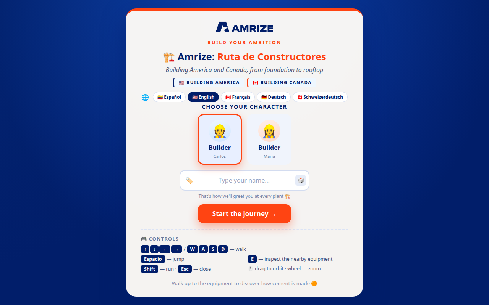
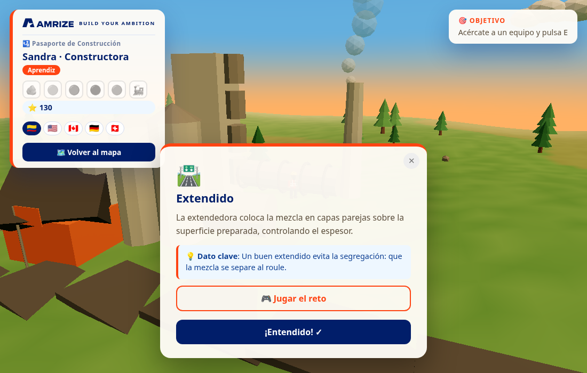
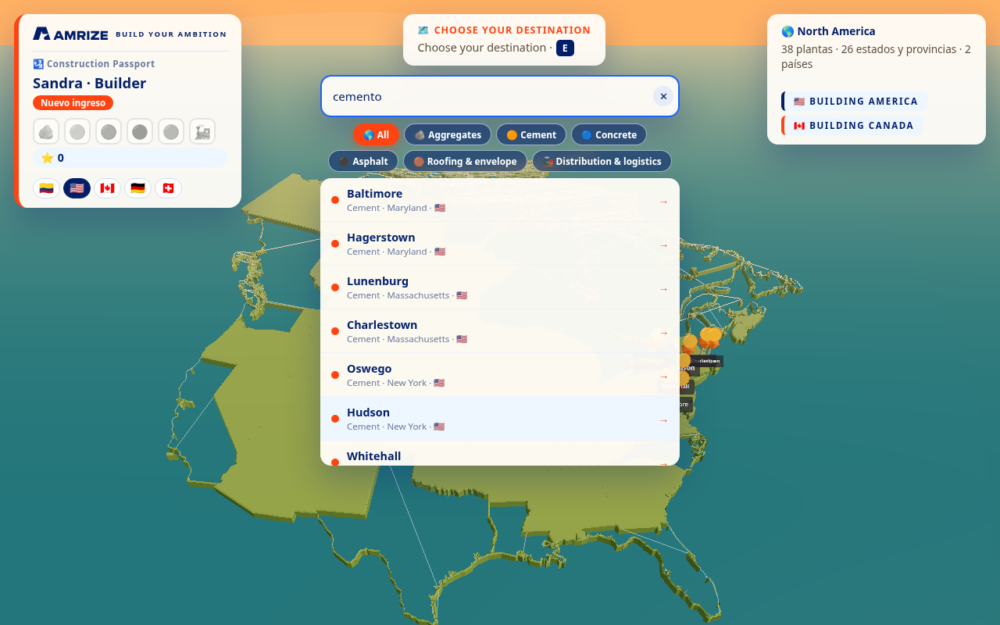
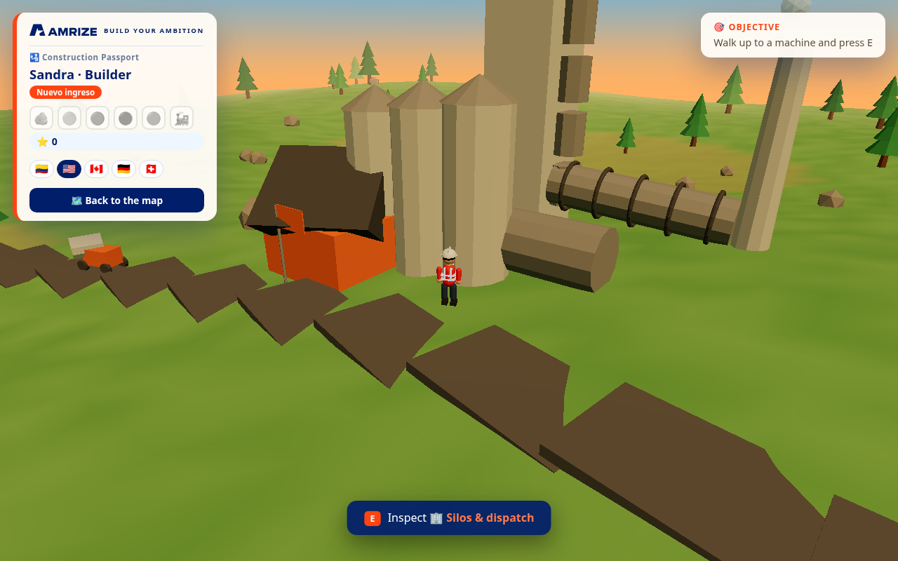
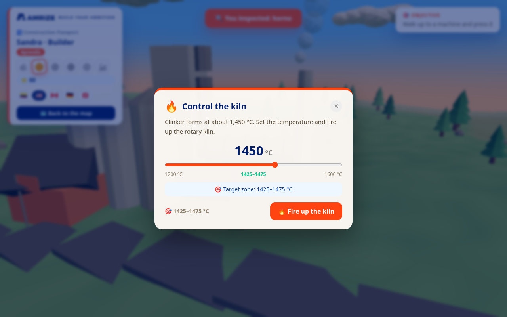

<div align="center">


# Amrize: Ruta de Constructores 🏗️

**Juego educativo 3D para recorrer las plantas de Amrize en Estados Unidos y Canadá.**

*Build your ambition* · 🇺🇸 Building America · 🇨🇦 Building Canada

[](https://github.com/tama8947/knowing-amrize-game/actions/workflows/ci.yml)
[](https://threejs.org/)
[](https://vitejs.dev/)
[](roadmap/09-lanzamiento.md)

</div>

---

## 🌎 ¿Qué es?

Un juego web en 3D donde el jugador recorre **Norteamérica** visiting las
plantas de Amrize y aprendiendo **cómo se hace** cada material: cemento,
concreto, agregados, asfalto, roofing y logística.

> *Amrize es la compañía de materiales de construcción de Norteamérica, con
> presencia en el 100% de los estados de EE.UU. y de las provincias de Canadá,
> más de 1.000 sitios y dos líneas de negocio: Building Materials y Building
> Envelope — «de la fundación al techo».*

### ✨ Características

- 🗺️ **Mapa 3D de Norteamérica** con geometría real de 50 estados y 13 provincias
  (proyección Albers) y **38 plantas reales** con sus coordenadas
- 🔎 **Buscador** por planta o ciudad, con filtro por línea de negocio y
  **vuelo animado** de la cámara hasta el destino
- 🚶 **Personaje jugable** con nombre personalizable: caminar, correr, saltar
  e inspeccionar la maquinaria
- 🏭 **6 plantas completas** con 35 estaciones educativas interactivas
- 🌍 **5 idiomas** (ES · EN · FR · DE · CH) con traducción **en caliente**
- 🛂 **Pasaporte de construcción** con sellos y rango de progreso
- 🎨 Identidad corporativa oficial: logo, azul `#011E6A` y naranja `#FF4412`
- 📱 Modo ligero automático en móviles (`?lowfx=1`)
- 🧠 **6 minijuegos educativos** con puntos de sostenibilidad (ver abajo)
- 🧪 **51 pruebas end-to-end** con Chromium headless
- 🔄 **CI/CD**: cada push compila, prueba y publica en GitHub Pages

---

## 🚀 Inicialización

Este proyecto usa **[pnpm](https://pnpm.io)** como gestor de paquetes.

### Requisitos previos

| Herramienta | Versión mínima | Comprobación |
|---|---|---|
| Node.js | 18 o superior | `node --version` |
| pnpm | 9 o superior | `pnpm --version` |

Si no tienes pnpm, instálalo con Corepack (viene incluido con Node.js ≥ 16.10):

```bash
corepack enable pnpm
# o bien, de forma global:
npm install -g pnpm
```

### Pasos

```bash
# 1. Clonar el repositorio
git clone https://github.com/tama8947/knowing-amrize-game.git

# 2. Entrar en la carpeta
cd knowing-amrize-game

# 3. Instalar las dependencias
pnpm install

# 4. Arrancar el servidor de desarrollo
pnpm dev
```

Abre <http://localhost:5173> en el navegador. 🎉

> **Nota:** el repositorio incluye `pnpm-lock.yaml`, así que las versiones de
> las dependencias quedan fijadas y el `install` es reproducible.

### Otros comandos

| Comando | Qué hace |
|---|---|
| `pnpm dev` | Servidor de desarrollo con HMR |
| `pnpm build` | Build de producción → `dist/` |
| `pnpm preview` | Previsualiza el build |
| `pnpm test:e2e` | 51 pruebas end-to-end (Playwright + Chromium) |
| `pnpm screenshots` | Regenera las capturas de `docs/` |
| `pnpm data:map` | Regenera la geometría del mapa |
| `pnpm data:plants` | Regenera el catálogo de plantas |

### ¿Primera vez con las pruebas?

Las pruebas end-to-end necesitan el navegador de Chromium, que se descarga la
primera vez (~120 MB):

```bash
pnpm exec playwright install chromium
pnpm test:e2e
```

### Problemas frecuentes

<details>
<summary><b>«Cannot find module 'three'» o errores de resolución</b></summary>

Las dependencias no están instaladas o el `node_modules` está incompleto:

```bash
pnpm install
```
</details>

<details>
<summary><b>«ERR_PNPM_IGNORED_BUILDS»</b></summary>

pnpm 10+ bloquea los scripts de instalación por seguridad. Este proyecto lo
autoriza explícitamente en `pnpm-workspace.yaml`:

```yaml
allowBuilds:
  esbuild: true
```

Si sigue apareciendo, ejecuta `pnpm rebuild esbuild`.
</details>

<details>
<summary><b>El puerto 5173 está ocupado</b></summary>

```bash
pnpm dev --port 3000
```
</details>

<details>
<summary><b>La página va lenta o se traba</b></summary>

En equipos modestos o móviles se activa automáticamente el modo ligero (sin
sombras, pixel ratio 1). Para forzarlo: `pnpm dev -- --host` y abre la URL con
`?lowfx=1`.
</details>

---

## 🎮 Controles

| Tecla | Acción |
|---|---|
| `↑ ↓ ← →` / `W A S D` | Caminar (relativo a la cámara) |
| `Espacio` | Saltar |
| `Shift` | Correr |
| `E` | Inspeccionar el equipo cercano |
| `Esc` | Cerrar la tarjeta |
| 🖱️ Arrastrar | Girar la cámara |
| 🖱️ Rueda | Zoom |
| Click en el suelo | Caminar hasta el punto |

---

## 🧠 Minijuegos

Al inspeccionar ciertas estaciones (botón **«Jugar el reto»** en la tarjeta)
se desbloquea un minijuego. Superarlo otorga **+20 puntos de sostenibilidad**
la primera vez (después puedes repetirlo sin puntos):

| Reto | Estación | ¿Qué enseña? |
|---|---|---|
| 🔥 **Controla el horno** | Cemento → Horno | El clinker se sinteriza a ~1.450 °C: ni frío ni quemado |
| 🧱 **Dosifica el concreto** | Concreto → Dosificación | Rangos reales por m³ y relación agua/cemento ≤ 0.50 |
| 🪨 **Clasifica en la zaranda** | Aggregates → Zarandeo | Granulometría: arena, grava y roca por tamaño |
| 🛣️ **Extiende el asfalto** | Asphalt → Extendido | Compactación pareja: 3 pasadas sin oscilaciones |
| 🧩 **Ordena el proceso** | Roofing y Logística | El orden real de las etapas de fabricación y entrega |

Los puntos se guardan en `localStorage` junto con el pasaporte y se muestran
en el HUD (⭐). Los retos están traducidos a los 5 idiomas y se re-traducen
en caliente.

---

## 🏗️ Arquitectura

**Vite + JavaScript vanilla + Three.js**, sin framework de UI: Three.js ya
gestiona su propio render loop y una capa de reconciliación solo añadiría
complejidad.

```
src/
├── main.js            bootstrap: modos 'menu' → 'map' → 'plant'
├── core/              motor (Engine, Sky)
├── world/             terreno, scenery, mapa 3D, plantas
├── game/              jugador, input, interacción, estado
├── ui/                interfaz DOM (menú, HUD, buscador, tarjetas)
├── i18n/              motor multiidioma + 5 locales
└── data/              contenido educativo y datos generados
```

Detalle completo en [`AGENTS.md`](AGENTS.md).

---

## 🌍 Multiidioma

| Código | Idioma | Bandera |
|---|---|---|
| `es` | Español | 🇨🇴 |
| `en` | English | 🇺🇸 |
| `fr` | Français | 🇨🇦 |
| `de` | Deutsch | 🇩🇪 |
| `ch` | Schweizerdeutsch | 🇨🇭 |

El idioma se detecta automáticamente del navegador y se puede cambiar en
cualquier momento: **se re-traducen también las tarjetas abiertas**, el letrero
de proximidad y los resultados del buscador, sin recargar la página.

---

## 🧰 Scripts de datos

Dos scripts regeneran los datos desde sus fuentes originales, de forma
reproducible:

```bash
pnpm data:map      # Natural Earth 10m admin-1 → geometría del mapa
pnpm data:plants   # ubicaciones de amrize.com → catálogo de plantas
```

O directamente:

```bash
node tools/build-map-data.mjs
node tools/build-plants.mjs
```

La geometría usa Douglas–Peucker para simplificar y la **proyección Albers
Equal Area Conic**, la oficial de Norteamérica.

---

## 🗺️ Roadmap

El estado completo del proyecto, fase a fase, está en [`roadmap/`](roadmap/README.md):

| Fase | Tema | Estado |
|---|---|---|
| [0](roadmap/01-identidad.md) | Identidad corporativa | ✅ |
| [1](roadmap/02-mapa-norteamerica.md) | Mapa de Norteamérica | ✅ |
| [1 bis](roadmap/03-buscador.md) | Buscador de plantas | ✅ |
| [1 ter](roadmap/04-personaje.md) | Personaje jugable | ✅ |
| [2](roadmap/05-plantas.md) | Contenido de las 6 plantas | ✅ |
| [3](roadmap/06-sistema-juego.md) | Sistema de juego | 🔶 |
| [4](roadmap/07-multiidioma.md) | Multiidioma | ✅ |
| [4 bis](roadmap/08-interfaz.md) | Interfaz y usabilidad | ✅ |
| [5](roadmap/09-lanzamiento.md) | Lanzamiento | ⬜ |
| — | [Backlog](roadmap/10-backlog.md) | 📝 |

---

## 📄 Documentación

- [`AGENTS.md`](AGENTS.md) — reglas para asistentes de IA y colaboradores
- [`docs/game-design.md`](docs/game-design.md) — Game Design Document
- [`docs/plants-content.md`](docs/plants-content.md) — contenido educativo por planta
- [`roadmap/`](roadmap/) — plan de trabajo

---

## 📸 Capturas

| Menú | Mapa | Buscador | Planta |
|---|---|---|---|
| Menú | Mapa | Buscador | Planta | Minijuego |
|---|---|---|---|---|
|  |  |  |  |  |

---

## 🌐 Despliegue

El workflow [`.github/workflows/ci.yml`](.github/workflows/ci.yml) se ejecuta
en cada *push* y *pull request* a `main`:

1. Instala con pnpm (lockfile congelado) y compila
2. Ejecuta las 51 pruebas end-to-end con Chromium
3. En cada *push* a `main`, publica `dist/` en **GitHub Pages**

---

## ⚖️ Marca y licencia

El logotipo de Amrize y los colores corporativos son propiedad de
Amrize Ltd. y se usan aquí con fines educativos y de demostración. La licencia
del código se publicará con el lanzamiento (ver
[roadmap/09-lanzamiento.md](roadmap/09-lanzamiento.md)).

---

<div align="center">
  <sub>Construido con Three.js · Datos de Natural Earth (dominio público) y amrize.com</sub>
</div>
